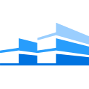
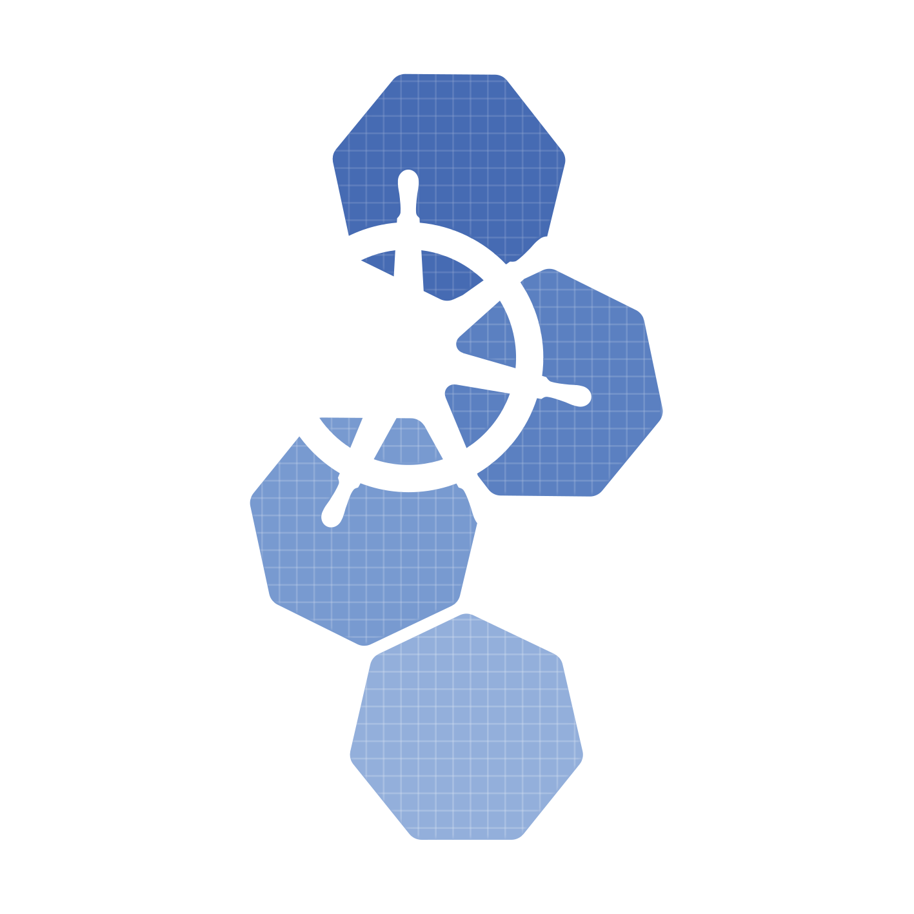
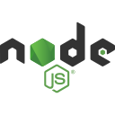
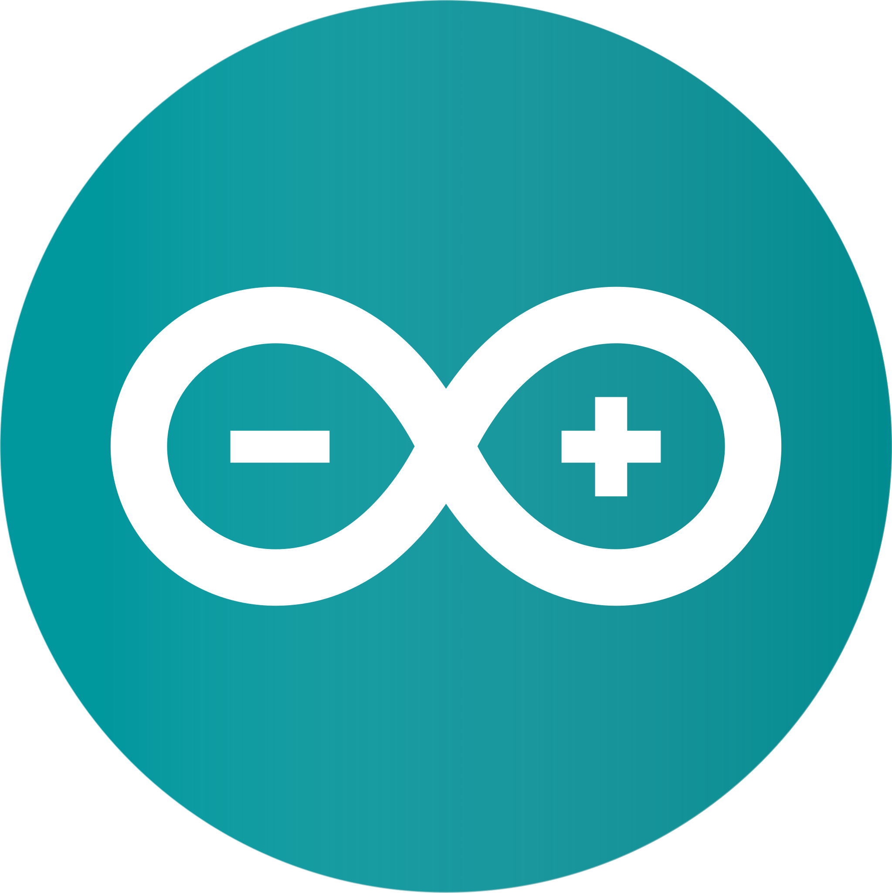
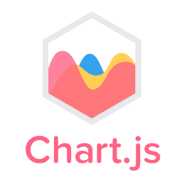
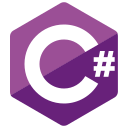
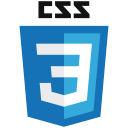
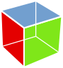
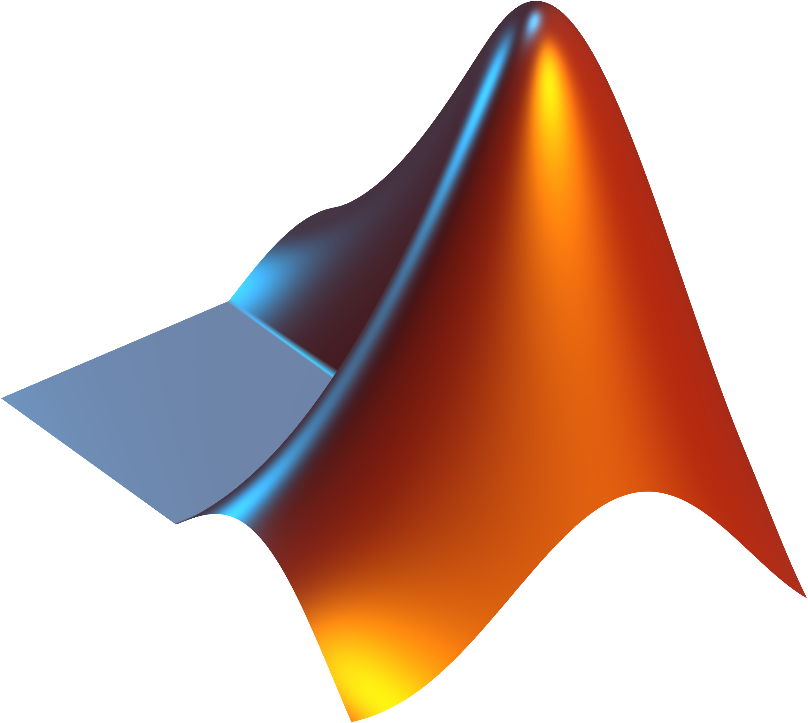

<h1 align="center">Hi 👋, I'm gm42</h1>
<h3 align="center">Distributed systems, metadata & databases :zap: Crafting Kubernetes operators :gear:</h3>

  
  

- 🌐 I build the **metadata** layer for distributed databases

- 🛠️ I build **Kubernetes operators** with Go and Kubebuilder

- 📝 I sometimes write articles on [HackerNoon](https://hackernoon.com/u/gmaz42)

- 💬 Ask me about **agent harness design**

- ⚡ Fun fact: **electronics hobbyist**

  
  
  
  
  
  
  
  
  
  
  
  
  
  

  
  
  
  
  
  
  
  
  
  
  

  
  
  
  
  
  
  
  
  
  
  

  
  
  
  
  
  
  
  
  
  
  
  
  
  
  
  
  
  
  
  
  
  
  
  
  
  
  
  
  
  
  
  
  
  
  
  
  
  
  
  
  
  
  
  
  

